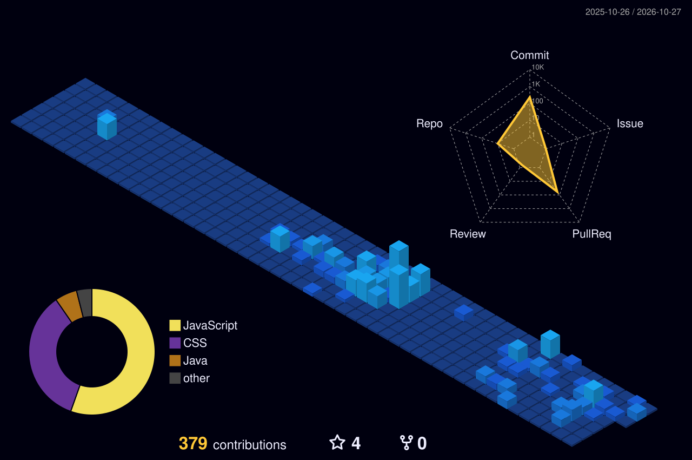

# Kaio Alves

**Desenvolvedor Back-end em formação**
Estudante de Sistemas para Internet no Senac São Paulo

---

## Sobre mim

- Cursando **Tecnologia em Sistemas para Internet** no Senac São Paulo (2025–2027)
- Ensino técnico integrado em desenvolvimento de sistemas no SENAI Morvan Figueiredo
- Projeto **Inova Senai 2024**: entre os 25 melhores do estado de São Paulo
- Foco em **APIs REST** e back-end, com interesse em arquitetura limpa
- Estudando **Java e Spring Boot** e migrando projetos de Node para Spring
- Também desenvolvo apps mobile com **React Native e Expo**
- Buscando estágio em desenvolvimento back-end (São Paulo, presencial ou híbrido)

---

## Tecnologias

| Área | Tecnologias |
|------|-------------|
| **Back-end** | Node.js, Express, Prisma, Java, Spring Boot, Python |
| **Banco de dados** | MySQL |
| **Mobile** | React Native, Expo |
| **Ferramentas** | Git, GitHub |

---

## Projetos em destaque

| Projeto | Descrição | Stack |
|---------|-----------|-------|
| **Limbus CRUD** | API CRUD estilo wiki com models de sinner, identity e skill | Node, Express, Prisma, MySQL |
| **PetVitaliz Service** | API REST migrada de Express para Spring Boot | Java, Spring Boot |
| **Projeto Final Senac** | API REST sobre uma clinica odontologica | Python, Django |

---

## Atividade no GitHub

Contribuições dos últimos 12 meses

---

## Contato

